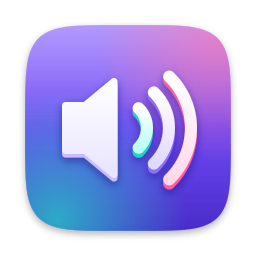

# Relief

**Sound in relief.**
3D surround, a 10-band equalizer, a volume booster, audio effects and per-app volume for macOS 14.4+.
A native app (Swift, Core Audio), **free and open source** (MIT): your sound never leaves your Mac.

**[Download Relief](https://github.com/Lightmaster00/relief/releases/latest/download/Relief.dmg)** · [Website](https://lightmaster00.github.io/relief/) · [All releases](https://github.com/Lightmaster00/relief/releases)



## Install

1. Download `Relief.dmg`, open it and drag **Relief** into *Applications*.
2. On first launch, macOS may say the app comes from an unidentified developer:
   open *System Settings › Privacy & Security* and click **Open Anyway**.
3. Allow **System Audio Recording** when macOS asks: Relief needs it to process the sound of your apps.
   Nothing is recorded or saved.

Relief lives in the menu bar. Later updates install from inside the app, in one click.

## Features

The interface follows the system language (English, French, Spanish, German, Japanese; English otherwise).

- **Volume booster**: up to +12 dB, with a limiter that prevents clipping and distortion.
- **3D surround**: a wider, deeper stereo image, tuned separately for **speakers** (mid/side widening,
  the bass stays centred) and **headphones** (crossfeed with head shadow, for a sound that comes from
  in front of you instead of inside your head).
- **Equalizer**: 10 bands (32 Hz – 16 kHz, ±12 dB), 16 presets (Bass Booster, Vocal, Rock, Podcast,
  Movie, Small Speakers…), your own presets, and a live frequency-response curve.
  Double-click a band to reset it.
- **Effects**: *Ambience* (room reverb), *Clarity* (presence and air), *Bass Boost* and *Night Mode*
  (a gentle compressor that evens out loud and quiet passages).
- **Per-app volume**: every app that plays sound gets its own slider (0–150 %) and a mute button.
  Volumes are kept for next time.
- **Output and volume**: choose the output (speakers, AirPods, DAC, AirPlay…) and set the system
  volume right from the panel. Switching outputs is picked up automatically, at any sample rate.
- **Speakers or headphones, automatically**: Bluetooth and the headphones jack switch the 3D effect to
  headphones mode; your choice is remembered for each output.
- **Global shortcuts**: turn Relief on or off (⌃⌥⌘R by default), show the panel, turn the equalizer
  or night mode on or off, next preset, speakers/headphones, booster up or down — with an on-screen
  confirmation like the system volume overlay.
- **Quick menu**: right-click the menu bar icon for presets, speakers/headphones and settings.
- **Automatic standby**: after 20 seconds of silence Relief releases the output device (saves
  battery) and wakes up as soon as an app plays sound.
- **One switch**: turn Relief off and your Mac plays its normal sound.

## How it works

Relief uses Core Audio *process taps* (macOS 14.4+). A tap captures the sound of every app (except
Relief itself) and mutes the original; Relief processes it and plays it on the current output through
a private aggregate device. Apps with their own volume get their own tap. If Relief quits or
crashes, the taps disappear with it and your Mac's sound goes back to normal.

The processing chain runs on the real-time audio thread without allocating or locking:
equalizer → bass → clarity → 3D surround → ambience → night mode → booster → limiter (−0.3 dBFS).

## Development

```bash
./build.sh install   # build, install /Applications/Relief.app and relaunch
./build.sh test      # automated tests
./build.sh run       # launch the build/ copy without installing it
./build.sh dmg       # build/Relief.dmg
```

- **Permissions are kept**: builds are signed with the "Relief Signing" certificate from your
  keychain (created on the first build), so *System Audio Recording* isn't asked again.
- **Continuous integration**: every push builds the app, runs the tests (including with the Address
  and Thread Sanitizers) and produces a DMG on a Mac (repository *Actions* tab).

## Publishing a release

Releases are built and published by GitHub automatically
([Release workflow](.github/workflows/release.yml)):

1. Change `CFBundleShortVersionString` in `Resources/Info.plist` (e.g. `1.0.1`) and push to `main`.
2. GitHub tests the app, builds and signs it, and publishes `Relief.dmg` (downloads) and
   `Relief.zip` (in-app updates) on the [Releases](https://github.com/Lightmaster00/relief/releases) page.

Installed copies check for updates at launch and every 24 hours (can be turned off in the
settings menu) and offer *Install and Restart*.

**One-time setup** (repository owner): `./build.sh setup-signing` creates the signing certificate,
installs it in your keychain and stores it as a GitHub secret. Local builds and GitHub releases then
share the same signature, so updates are accepted and macOS keeps its permissions.

## Contributing

Contributions are welcome: open an *issue* to report a bug or suggest an idea, or a *pull request*
(the tests must pass: `./build.sh test`).

## Project layout

```
Sources/Relief/
  AppDelegate.swift        entry point, menu bar item and panel
  PanelView.swift          interface (sound, equalizer, apps)
  Model.swift              settings, presets, per-app volumes, launch at login
  SoundSettings.swift      settings and equalizer presets
  AudioEngine.swift        process taps, aggregate device, real-time render callback
  SoundProcessor.swift     the processing chain
  DSP.swift                filters, delay lines, reverb
  AppAudio.swift           apps that play sound
  AudioPermission.swift    System Audio Recording permission
  CoreAudioHelpers.swift   Core Audio property access
  Updater.swift            updates from GitHub releases
  OutputDevices.swift       output list, system volume, headphones detection
  SettingsView.swift       settings window (general, shortcuts, updates, about)
  Shortcuts.swift          global shortcuts and their recorder
  HotKeys.swift            Carbon hot keys (no Accessibility permission needed)
  HUD.swift                on-screen confirmation for shortcuts
  Brand.swift              menu bar icon and app icon view
  Localization.swift       interface strings (5 languages)
Tests/ReliefTests/         tests (filters, limiter, sample rates, settings, versions)
Branding/                  icon, installer background and brand guide (BRAND.md)
site/                      website (published with GitHub Pages)
```

## License

MIT — see [LICENSE](LICENSE). The "Relief" name and icon identify this project.
